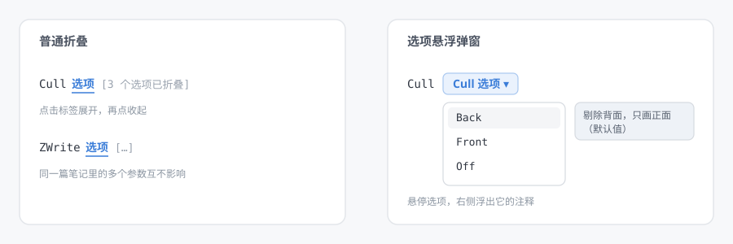

# 代码块参数折叠

给 Obsidian 的代码块加一层「参数折叠」：把 `参数[一堆选项]` 这样的长文本折叠成一个可点击的标签，
点开看原文，或者直接切换成鼠标悬浮就能看选项与注释的弹窗。

适用于任何写参数的场景——Shader 指令、引擎配置、命令行开关、枚举值——只要你能把它写成
`名称[内容]`。



## 功能

- **普通折叠**：`参数[很长的选项列表]` → 只显示蓝色下划线的 `参数`，`[内容]` 收起来；点一下展开。
- **选项悬浮弹窗**：折叠成一个药丸状的 `参数 ▾`，鼠标移上去浮出选项列表，再移到某个选项上浮出它的注释。
- **右键菜单**：在标签上右键即可编辑选项、切换显示方式、展开或取消折叠。
- **命令面板**：`折叠选中的参数内容`、`取消光标处的参数折叠`。
- **记录跟着笔记走**：折叠位置写进插件数据，重开笔记自动恢复；笔记重命名时记录跟着迁移。

## 安装

### 手动安装（任意库通用）

1. 下载本仓库（`Code → Download ZIP`），或从 Releases 下载 `manifest.json`、`main.js`、`styles.css`。
2. 在你的库目录下建文件夹 `<你的库>/.obsidian/plugins/code-block-context-fold/`。
3. 把上面三个文件放进去。
4. Obsidian → 设置 → 第三方插件 → 关闭「安全模式」→ 刷新 → 启用「代码块参数折叠」。

插件不绑定任何库：每个库各自保存自己的折叠记录，互不影响。

### 开发时一键部署

```bash
node scripts/deploy.mjs --vault "D:\某个库"
```

只复制三个产物文件，不会动目标库里的 `data.json`。

## 用法

### 直接折叠一段文本

在一个代码块里选中完整的 `参数[内容]`（支持多行、支持嵌套方括号），然后：

- 右键 → **折叠选中参数**，或
- 命令面板 → **折叠选中的参数内容**

### 用面板插入选项

1. 光标放在代码块里（不在代码块里也可以，插件会自动包一层 ```text 围栏）。
2. 命令面板 / 右键 → **插入参数选项…**。
3. 填参数名称，逐个添加「选项 + 注释」，保存。

生成的文本格式：

```
混合模式[
  Normal//正常混合_
  Add//相加，越高越亮
]
```

- 选项之间用 `_` 分隔，`//` 之后是注释。
- 名称、选项、注释里不能出现方括号和下划线，否则无法区分结构。

### 两种显示方式

在标签上右键 → **显示方式：普通折叠 / 选项悬浮弹窗**。切换只影响显示，不修改笔记内容。

## 数据与隐私

折叠记录存在 `.obsidian/plugins/code-block-context-fold/data.json`，只在本机：

- 记录的是**库内相对路径**和用于重新定位的锚点（代码块语言、块序号、行号、前后 64 字符上下文）。
- 因为锚点里带着笔记正文片段，这个文件已写进 `.gitignore`，不要提交、不要分享。
- 换个库安装，等于从零开始，不会串数据。

## 已知限制

- **只在编辑视图生效**。阅读视图和导出 PDF 里仍然是原始文本，插件目前没有实现 `registerMarkdownPostProcessor`。
- `_` 与 `[ ]` 属于结构字符，不能出现在参数名、选项名或注释里。
- 笔记被改动后，插件靠锚点重新定位折叠位置；当同一段文本出现多次且锚点无法区分时，它会放弃恢复而不是猜一个位置。

## 开发

```bash
npm run build        # 零依赖打包：src/ → main.js
npm run build:esbuild # 用 esbuild 打包（需先 npm i）
npm test             # 单元测试（Node 内置 test runner）
```

`npm run build` 用的是 `scripts/build.mjs`——一个只做「把相对 require 内联成单文件」的
零依赖打包器，所以 clone 下来不装任何东西也能构建。`obsidian` 与 `@codemirror/*`
始终作为外部依赖，由 Obsidian 运行时提供。

### 目录结构

```
src/
  main.js                 插件生命周期、右键菜单、命令、数据读写
  state.js                共享的插件实例与右键上下文
  editor/blocks.js        代码围栏扫描
  editor/selection.js     选区 → 折叠区域
  editor/anchor.js        锚点采集
  editor/recover.js       重开笔记时的位置复原
  editor/decorations.js   CodeMirror StateField、装饰、鼠标交互
  format/parameters.js    参数表达式解析与序列化
  ui/options-widget.js    选项悬浮弹窗
  ui/setup-modal.js       参数选项编辑弹窗
  util/{id,text}.js       小工具
scripts/
  build.mjs               零依赖打包
  deploy.mjs              部署到任意库
test/                     单元测试
docs/                     README 用图
main.js                   构建产物（随仓库分发）
```

## 发布

1. 把 `manifest.json` 里的 `author` 改成你自己的署名（当前仍是占位值 `Local`）。
2. 更新 `manifest.json` 的 `version`，并在 `versions.json` 里补一行 `"版本": "最低 Obsidian 版本"`。
3. `npm run build`，确认 `main.js` 已更新。
4. 打 tag（与 version 一致），在 Releases 里附上 `manifest.json`、`main.js`、`styles.css`。

## 许可证

GPL-3.0-or-later，见 [LICENSE](LICENSE)。
