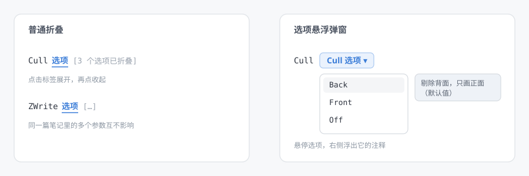

[English](README.md) | 简体中文

# 代码块参数折叠

给 Obsidian 的代码块加一层「参数折叠」：把 `参数[一堆选项]` 这样的长文本折叠成一个可点击的标签，
点开看原文，或者直接切换成鼠标悬浮就能看选项与注释的弹窗。

适用于任何写参数的场景——Shader 指令、引擎配置、命令行开关、枚举值——只要你能把它写成
`名称[内容]`。

仓库：<https://github.com/zhongxiaguchen/code-block-context-fold>　·　最新版本：3.3.0



## 功能

- **普通折叠**：`参数[很长的选项列表]` → 只显示蓝色下划线的 `参数`，`[内容]` 收起来；点一下展开。
- **选项悬浮弹窗**：折叠成一个药丸状的 `参数 ▾`，鼠标移上去浮出选项列表，再移到某个选项上浮出它的注释。
- **右键菜单**：在标签上右键即可编辑选项、切换显示方式、展开或取消折叠。
- **命令面板**：`折叠选中的参数内容`、`取消光标处的参数折叠`、`打开折叠总览`。
- **编辑视图和阅读视图都生效**：切到阅读视图、导出 PDF 时折叠依然保留，标签可以点击展开。
- **记录跟着笔记走**：折叠位置写进插件数据，重开笔记自动恢复；笔记重命名时记录跟着迁移。
- **有设置页和折叠总览**：默认显示方式、阅读视图开关；总览里能盘点、跳转、逐条删除、清理失效记录。

## 安装

### 手动安装（任意库通用）

1. 从 [Releases](https://github.com/zhongxiaguchen/code-block-context-fold/releases) 下载
   `manifest.json`、`main.js`、`styles.css` 三个文件（或直接下 `code-block-context-fold-3.3.0.zip` 解压）。
2. 在你的库目录下建文件夹 `<你的库>/.obsidian/plugins/code-block-context-fold/`。
3. 把三个文件平铺放进去（不要多套一层文件夹）。
4. Obsidian → 设置 → 第三方插件 → 关闭「安全模式」→ 刷新 → 启用「代码块参数折叠」。

插件不绑定任何库：每个库各自保存自己的折叠记录，互不影响。

### 从 2.x 升级到 3.0

3.0 把选项分隔符从 `_` 改成了换行。如果你之前用「插入参数选项」面板生成过内容，
跑一次迁移脚本（默认只预演，`--apply` 才写盘，写入前自动备份）：

```bash
node scripts/migrate-legacy-format.mjs --vault "D:\某个库" --apply
```

手写的单行 `A[a/b/c]` 不会被改写。

### 开发时一键部署

```bash
node scripts/deploy.mjs --vault "D:\某个库"
```

只复制三个产物文件，不会动目标库里的 `data.json`。

## 用法

### 直接折叠一段文本

在一个代码块里选中完整的 `参数[内容]`（支持多行、支持嵌套方括号），然后：

- 右键 → **折叠选中参数**，或
- 命令面板 → **折叠选中的参数内容**

### 用面板插入选项

1. 光标放在代码块里（不在代码块里也可以，插件会自动包一层语言标记为 `text` 的代码围栏）。
2. 命令面板 / 右键 → **插入参数选项…**。
3. 填参数名称，逐个添加「选项 + 注释」，保存。

生成的文本格式：

```
混合模式[
  Normal//正常混合
  Add//相加，越高越亮
]
```

- **一行一个选项**，`//` 之后是注释。
- 参数名、选项名里不能出现方括号和换行；注释里不能出现方括号。`_`、`=`、`+` 这些都可以随便用。
- 注释支持多行输入，落盘时会压成一行（换行现在是选项分隔符）。

### 两种显示方式

在标签上右键 → **显示方式：普通折叠 / 选项悬浮弹窗**。切换只影响显示，不修改笔记内容。

想在设置里改新折叠的默认形态，见下面的「设置与总览」。

## 设置与总览

设置 → 第三方插件 → 代码块参数折叠：

- **默认显示方式**：新折叠用普通折叠还是选项悬浮弹窗；已存在的项目可以在标签上右键单独切换。
- **阅读视图也折叠**：关掉后只在编辑视图生效，阅读视图和导出 PDF 保持原文。
- **折叠总览**：按笔记分组列出本库所有折叠，点笔记名直接跳过去，逐条删除，也能一键清理指向已删除笔记的失效记录。顶部有搜索框，可按标签、选项内容或笔记名过滤。

总览也可以从左侧栏的列表图标，或命令面板「打开折叠总览」打开。

## 数据与隐私

**不联网、不收集任何数据、没有统计和遥测。** 插件只做两件事：读当前库里的笔记，把折叠位置写进本机的一个 json。

折叠记录存在 `.obsidian/plugins/code-block-context-fold/data.json`，只在本机：

- 记录的是**库内相对路径**和用于重新定位的锚点（代码块语言、块序号、行号、前后 64 字符上下文）。
- 因为锚点里带着笔记正文片段，这个文件已写进 `.gitignore`，不要提交、不要分享。
- 换个库安装，等于从零开始，不会串数据。

## 已知限制

- **阅读视图的展开状态是一次性的**：在阅读视图里点开标签只影响当前渲染，不会写回编辑视图；编辑视图以插件数据里记录的展开状态为准。
- **阅读视图和编辑视图用同一套锚点定位**：不再要求原文一字不差，改过的内容也能找回折叠位置。代价是每次渲染会读一次笔记源码（按文件缓存，文件变动时失效）；如果两个代码块内容完全相同，会按出现顺序各自对应。
- 方括号 `[ ]` 属于结构字符，不能出现在参数名、选项名或注释里（`_` 已经没有限制了）。
- 笔记被改动后，插件靠锚点重新定位折叠位置；当同一段文本出现多次且锚点无法区分时，它会放弃恢复而不是猜一个位置。
- **界面文案目前只有中文**，英文界面还没有做。

## 开发

需要 Node.js ≥ 22.8。

```bash
npm run build         # 零依赖打包：src/ → main.js
npm run build:esbuild # 用 esbuild 打包（需先 npm i）
npm test              # 单元测试（Node 内置 test runner）
npm run release       # 校验 + 构建 + 测试 + 打包 zip
```

`npm run build` 用的是 `scripts/build.mjs`——一个只做「把相对 require 内联成单文件」的
零依赖打包器，所以 clone 下来不装任何东西也能构建。`obsidian` 与 `@codemirror/*`
始终作为外部依赖，由 Obsidian 运行时提供。

### 目录结构

```
src/
  main.js                 插件生命周期、右键菜单、命令、数据读写
  state.js                共享的插件实例与右键上下文
  editor/blocks.js        代码围栏扫描
  editor/selection.js     选区 → 折叠区域
  editor/anchor.js        锚点采集
  editor/recover.js       重开笔记时的位置复原
  editor/decorations.js   CodeMirror StateField、装饰、鼠标交互
  editor/text-range.js    跨文本节点的区间定位（阅读视图用）
  reading/source.js       阅读视图的源码快照与锚点投影（复用编辑视图的打分）
  reading/render.js       阅读视图 / 导出时的折叠渲染
  format/parameters.js    参数表达式解析与序列化
  settings/defaults.js    设置项默认值与归一化
  settings/overview.js    折叠总览的数据投影
  ui/options-dom.js       选项药丸与悬浮面板的 DOM（编辑器与阅读视图共用）
  ui/options-widget.js    选项弹窗的 CodeMirror 组件封装
  ui/setup-modal.js       参数选项编辑弹窗
  ui/settings-tab.js      设置页
  ui/overview-modal.js    折叠总览弹窗
  util/{id,text}.js       小工具
scripts/
  build.mjs               零依赖打包
  deploy.mjs              部署到任意库
  migrate-legacy-format.mjs  旧格式迁移
  release.mjs             发布打包（校验 + zip）
test/                     单元测试
docs/                     README 用图与录制说明
.github/workflows/        tag 推送时自动建 Release
main.js                   构建产物（随仓库分发）
```

## 发布

完整清单见 [RELEASING.md](RELEASING.md)，核心四步：

1. 同步改 `manifest.json`、`package.json` 的 `version`，并在 `versions.json` 补条目。
2. `npm run release`。
3. `git tag <version>`（**不要加 `v` 前缀**）→ 推送。
4. 建 Release，附上 `manifest.json`、`main.js`、`styles.css` 和 zip。

推送 tag 时 `.github/workflows/release.yml` 会自动构建并创建 Release，也可以本地手动建。

## 许可证

GPL-3.0-or-later，见 [LICENSE](LICENSE)。

Copyright (C) 2026 Zonvon
